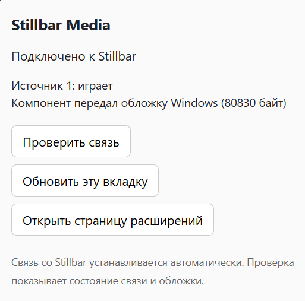

# Stillbar & Stillbar Media

Stillbar adds a customizable media player and optional island-style background to the Windows 11 taskbar. Stillbar Media connects media playing in Yandex Browser to the Windows application.

The application is now developed in its own repository: [miqonee/Stillbar](https://github.com/miqonee/Stillbar). This repository remains the source for the Stillbar Media extension; its copy of the application source is a historical snapshot.



## Features

- Playback controls, track information and artwork when provided by the media source.
- Optional taskbar islands, adjustable blur and appearance.
- Local browser integration through Native Messaging. The extension and the Stillbar application are both required for this integration.

## Status

Stillbar 0.7.0 and Stillbar Media 0.4.0 are pre-release software. The earlier browser prototype was checked with YouTube in Yandex Browser; the store release and the new native host identifiers still need end-to-end verification. Availability and controls depend on the website and browser. The published store extension ID and listing URL must be configured in the application before the store installation flow works.

For a review build of Stillbar for Windows and its test browser integration, see the [pre-release package](https://github.com/miqonee/Stillbar-Media/releases/tag/v0.7.0-review.1). This package is not the final store installation experience. The Windows application is required separately from the browser extension.

## Build the Windows application

Install Visual Studio 2022 C++ Build Tools and Windows SDK 26100 on Windows 11 x64. Run in PowerShell:

```powershell
.\build.ps1
```

The script creates a timestamped folder in `dist`. Run `Stillbar.exe` from that folder. The output includes the application, its core DLL, browser host, and the extension source. Build outputs and local settings are excluded from this repository.

## Browser extension

`browser-extension/` contains the source of the 0.4.0 Opera Add-ons package; no JavaScript bundling or minification is used. To produce a ZIP on Windows:

```powershell
Compress-Archive -Path .\browser-extension\* -DestinationPath .\Stillbar-Media-0.4.0.zip
```

The archive must have `manifest.json` at its root. The extension requires the local Stillbar application and a correctly configured native host. Store publication and installation are not yet verified.

## Privacy and support

See [Privacy](PRIVACY.html). Report issues via [GitHub Issues](https://github.com/miqonee/Stillbar-Media/issues). Media metadata is processed locally; cover images may be fetched from the URL supplied by the media site.

## License

Distributed under the [MIT License](LICENSE).
